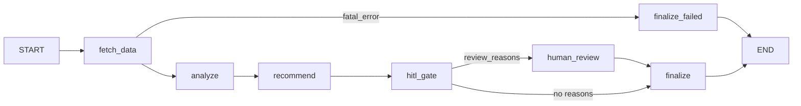

# Wealth Advisor Assistant — Multi-Agent System

A lightweight multi-agent system that prepares advisory decisions for a wealth advisor. It ingests a
client's financial JSON, enriches it with CRM context (mock API), analyses the portfolio and transactions
(including anomaly detection), and produces a **schema-validated JSON** plus a **text report** that the
advisor can approve, edit or reject before it is finalised.

- **Orchestration:** LangGraph `StateGraph` with deterministic routing, an in-memory checkpointer, and `interrupt`/`Command(resume=…)` for human-in-the-loop.
- **Agents:** Data Fetcher, Analyzer, Recommender. Plain Python classes that only talk to a `ToolRegistry`.
- **Runs offline and deterministically.** An LLM is optional, provider-agnostic, and only rewrites the narrative.
- **Fails in a controlled way:** retries, circuit breaker, CRM fallback from memory, partial results, and a `degraded` flag.
- **Bonus features:** short- and long-term memory (SQLite), HITL checkpoint, a separate Recommender agent, and recurring-alert suppression.

> Decision-support only. This is not investment advice; the advisor always makes the final decision.

---

## 1. Quick start (≤ 3 commands)

Requires Python 3.11+ and [uv](https://docs.astral.sh/uv/).

```bash
uv sync                                          # 1. install (creates .venv)
uv run wealth-advisor run-all --auto-approve     # 2. run every sample scenario
uv run pytest                                    # 3. (optional) run the 45 tests
```

Outputs are written to `output/` (`<client>.advisory.json` and `<client>.report.txt`), and the structured
log goes to `logs/wealth_advisor.jsonl`. Pre-generated outputs for every scenario are committed in
[`samples/output/`](samples/output).

Other useful commands:

```bash
uv run wealth-advisor run C002                    # one client; interactive HITL prompt in a TTY
uv run wealth-advisor run C001 --crm-failure timeout   # simulate a CRM outage (timeout|error_500|empty|flaky)
uv run wealth-advisor run C002 --non-interactive  # no prompt -> review.status = pending_review
uv run wealth-advisor history C002                # long-term memory for a client
uv run wealth-advisor tools                       # list the tool registry
uv run wealth-advisor schema --out schema.json    # JSON Schema of AdvisoryOutput
uv run wealth-advisor reset-memory -y             # clear long-term memory
```

Without uv: `python -m venv .venv && .venv/Scripts/pip install -e . pytest` (Windows) or
`.venv/bin/pip install -e . pytest`, then `wealth-advisor run-all --auto-approve`.

---

## 2. Architecture

```
CLI (Typer + rich)
   │  client_id
   ▼
Orchestrator  ── LangGraph StateGraph (state = short-term memory, InMemorySaver checkpointer)
   │
   ├─ fetch_data ──► DataFetcherAgent ──► load_client_data, crm_lookup, memory
   │      │  fatal (e.g. invalid JSON) ───────────────────────► finalize_failed ──► END
   │      ▼
   ├─ analyze ─────► AnalyzerAgent ────► portfolio_metrics, anomaly_detection, memory
   │      ▼          (failure → partial result, degraded)
   ├─ recommend ───► RecommenderAgent ─► narrative (LLM or template)
   │      ▼          (failure → minimal "manual review" draft)
   ├─ hitl_gate ── high severity? confidence < 0.70? degraded?
   │      ├─ yes ─► human_review  ── interrupt(packet) … Command(resume=decision)
   │      ▼                                    │
   └─ finalize ◄───────────────────────────────┘
          └─► AdvisoryOutput (schema round-trip) ──► memory.save_run / record_decision ──► END
```



### Components

| Component | File | Responsibility | Input → Output |
|---|---|---|---|
| Orchestrator | `orchestrator.py` | Builds the graph, deterministic routing, per-step status/attempts/duration, step-level retry of transient errors, degraded/HITL decisions, interrupt/resume loop | `client_id` → `RunResult` |
| Data Fetcher Agent | `agents/data_fetcher.py` | Load and validate data, fetch CRM, fall back to cached CRM, set an assumed risk profile when missing | `client_id` → `ClientContext` |
| Analyzer Agent | `agents/analyzer.py` | Metrics, anomaly detection, comparison with previous runs (trend + recurring alerts) | `ClientContext` → `AnalysisReport` |
| Recommender Agent | `agents/recommender.py` | Rule-based, evidence-linked recommendations; narrative via LLM or template | `ClientContext, AnalysisReport` → `AdvisoryDraft` |
| HITL | `hitl.py`, `cli.py` | Triggers, reviewers (console / auto-approve / pending / scripted), auditable decision application | packet → `ReviewDecision` → `ReviewInfo` |
| Tool layer | `tools/` | Uniform `Tool` interface + `ToolRegistry`; tools never raise | `dict` → `ToolResult` |
| Analytics | `analytics/` | Pure, deterministic metrics + 8 detectors (no I/O) | data → metrics / anomalies |
| Memory | `memory/` | Short-term = graph state; long-term = SQLite | — |
| LLM | `llm/` | `LLMProvider` interface + LangChain `init_chat_model` adapter | — |
| Composition root | `app.py` | The **only** place that knows concrete classes | settings → `Application` |

### Agent interaction (one run)

1. **CLI** creates a reviewer (interactive / `--auto-approve` / non-interactive) and calls `Orchestrator.run(client_id)`.
2. The orchestrator generates a `run_id`, initialises the state (all steps `pending`) and invokes the graph with `thread_id = run_id`.
3. **fetch_data**: the Data Fetcher calls `load_client_data`. An invalid JSON file becomes a `FatalStepError`, which routes the run to `finalize_failed`. It then calls `crm_lookup` (timeout, 2 retries with backoff, circuit breaker). If the CRM fails, it falls back to `memory.get_crm`, or continues without CRM. A missing risk profile is replaced by a conservative profile marked `assumed: true`.
4. **analyze**: the Analyzer calls `portfolio_metrics` and `anomaly_detection`, then `memory.get_history` to mark recurring or acknowledged anomalies and compute the trend.
5. **recommend**: the Recommender maps each anomaly to an action (with `linked_anomaly_ids`) and adds context actions (confirm risk profile, verify CRM, fix data, stale contact). The `narrative` tool asks the LLM if one is configured and otherwise uses the template.
6. **hitl_gate** computes confidence from the penalties collected so far and decides whether a review is needed. **human_review** calls `interrupt(packet)`; the orchestrator hands the packet to the reviewer and resumes with `Command(resume=decision)`.
7. **finalize** builds the `AdvisoryOutput`, round-trips it through the Pydantic schema, and persists the run and the decision through the `memory` tool.

Each agent output is a Pydantic model that is stored in the graph state as a JSON dict. This keeps checkpoints serialisable and keeps agents decoupled from LangGraph.

---

## 3. Tool abstraction

Every tool implements the same contract (`tools/base.py`):

```python
class Tool(ABC, Generic[InputT]):
    name: ClassVar[str]; description: ClassVar[str]; input_schema: ClassVar[type[BaseModel]]
    def execute(self, payload) -> ToolResult      # validate → run → time → log `tool_called`
    def _run(self, params, meta) -> Any           # implemented by subclasses; raise ToolFailure for expected errors

class ToolResult(BaseModel): ok: bool; data: Any; error: ToolError | None; meta: ToolMeta(duration_ms, retries, extra)
```

`execute` is a template method that converts **any** exception into `ToolResult(ok=False)`, so error
handling looks the same everywhere. Agents call `self.use("crm_lookup", client_id=...)`, which goes
through `ToolRegistry.get(name)`. They never import tool implementations; only `app.py` does.

| Tool (registry name) | Purpose |
|---|---|
| `load_client_data` | Load, validate and normalise client JSON; quarantine bad rows |
| `crm_lookup` | Mock CRM with timeout, retry/backoff and circuit breaker; failure injection |
| `portfolio_metrics` | Total assets, allocation, concentration, 30/90-day cash flow, value change, P&L |
| `anomaly_detection` | Runs every detector in isolation and reports per-detector status |
| `memory` | `get_history`, `save_run`, `get_crm`, `save_crm`, `record_decision` |
| `narrative` | LLM narrative via `LLMProvider`, template fallback |

---

## 4. Data model

* **Input** (`models/client.py`): `client`, `as_of`, `accounts[]`, `holdings[]`, `transactions[]`, `history[]` (optional, 90-day snapshots). Amounts are normalised to the client's base currency.
* **CRM** (`models/crm.py`): `risk_profile` (category + `max_equity_pct`), `goals[]`, `relationship` (tier, last contact, advisor), `notes[]`.
* **Output** (`models/advisory.py`, schema in [`samples/output/advisory_output.schema.json`](samples/output/advisory_output.schema.json)):

| Field | Meaning |
|---|---|
| `run_id`, `client_id`, `generated_at`, `as_of` | metadata |
| `summary`, `narrative_source` | advisor summary (`template` or `llm`) |
| `metrics` | portfolio metrics (null if analysis failed) |
| `anomalies[]` | `type`, `severity`, `evidence` (txn ids / numbers), `explanation`, `fingerprint`, `recurring`, `previously_acknowledged` |
| `recommendations[]` | `action`, `rationale`, `priority`, `linked_anomaly_ids`, `edited_by_reviewer` |
| `confidence`, `confidence_breakdown[]` | 1 − Σ penalties, with every deduction itemised |
| `degraded`, `degraded_reasons[]`, `crm_source` | `live` / `memory_cache` / `none` |
| `risk_profile`, `assumptions[]`, `data_quality[]`, `detectors[]`, `trend` | transparency and audit |
| `review` | `status` (approved / edited / rejected / pending_review / not_required), `mode`, `reviewer`, `note`, `changes[]`, `trigger_reasons[]` |
| `steps[]` | execution trace: status, attempts, duration, error |

---

## 5. Anomaly detection (`analytics/anomaly.py`, thresholds in `config/thresholds.yaml`)

| Type | Method | Default threshold | Severity |
|---|---|---|---|
| `unusual_amount` | Robust z-score (median/MAD) per (direction, category), ≥ 5 samples | z > 3.5 **or** > 5× median | medium; high if z > 7 or > 10× |
| `duplicate_transaction` | Same direction + amount + counterparty clustered within a window | ≥ 2 within 24 h | medium |
| `frequency_spike` | Daily counts (zero days included) vs mean + kσ | > mean + 3σ and ≥ 5/day | medium |
| `large_outflow` | Net outflow over 30 days / total assets | > 30% | high |
| `new_counterparty_high_value` | First-seen counterparty (needs ≥ 30 days of prior history) with a large outflow | ≥ IDR 100M | medium |
| `asset_concentration` | Single-issuer weight and sector weight of invested assets; sovereign bonds, index funds and cash excluded | > 40% | medium |
| `risk_profile_deviation` | Equity share of total assets vs the CRM `max_equity_pct` | above the limit | high (medium if the profile is **assumed**) |
| `value_decline` | 90-day portfolio value change from history | < −10% | medium |

* **Statistical** detectors (`unusual_amount`, `frequency_spike`) are skipped when there are fewer than 10 transactions. Rule-based detectors still run, and confidence is reduced.
* Each detector runs in isolation. A failing detector is reported as `failed` and does not affect the others.
* Each finding gets a stable `fingerprint` (e.g. `concentration:asset:GOTO`). Long-term memory uses it to mark findings as **recurring**. Recurring findings that the advisor already acknowledged are demoted one priority level and no longer trigger HITL on their own.
* **Recall on the injected anomalies:** `C002_anomalies.json` declares 8 injected anomaly types in `_injected_anomalies`, and all 8 are detected (100%, asserted by `test_injected_anomalies_recall_and_hitl`). The clean client `C001` produces **0** findings.

---

## 6. Error handling and fallback

| Failure | Handling (where) | Effect on output |
|---|---|---|
| CRM timeout / 5xx | 2 retries, exponential backoff 0.2 s / 0.4 s (`tools/resilience.py`); circuit breaker opens after 5 consecutive failed attempts, half-open after 30 s; fallback to cached CRM in long-term memory, otherwise continue without CRM | `degraded = true`, confidence −0.10 (cache) or −0.25 (none) |
| CRM empty / no risk profile | Conservative default profile with `assumed: true`; risk deviation severity lowered | assumption + “confirm risk profile” recommendation, −0.15 |
| CRM 404 | Treated as missing CRM data (degraded) | as above |
| Invalid JSON / missing `client` section | `ToolResult(ok=False, code=invalid_json \| schema_error)` → `FatalStepError` → `finalize_failed` | `RunResult(status=failed)` + `<client>.error.json`; the batch continues |
| Missing optional field | Default value + `data_quality` entry (`defaulted`) | −0.02 per field (cap 0.10) |
| Odd values | Negative outflow → normalised; negative inflow, invalid date, future date, duplicate id, unknown currency → **quarantined**; USD/SGD/EUR → converted at a static FX rate | quarantined rows listed, −0.05 each (cap 0.15) |
| Exception inside an agent | Caught by the orchestrator's `_execute`; step marked `failed`; non-critical steps continue (analysis → partial output, recommender → minimal draft); `TransientStepError` retried at step level | partial result, degraded, HITL forced |
| LLM unavailable | Template narrative | findings unchanged |
| HITL with no reviewer | `pending_review`, never auto-approved silently; `--auto-approve` is explicit and recorded as `mode: auto_approve` | needs manual review |
| Anything else in the graph | `Orchestrator.run` never raises; it returns `status=failed, code=orchestrator_error` | batch continues |

---

## 7. Logging and observability

* JSON lines go to `logs/wealth_advisor.jsonl`, and a compact summary goes to the console (WARNING+, or INFO with `-v`).
* Fields: `timestamp, level, run_id, agent, step, event, duration_ms, message, detail`. `run_id`, `agent` and `step` come from `contextvars`, so every line inside a run is correlated automatically.
* Events: `run_started`, `step_started`, `step_finished`, `tool_called` (input summary, ok, retries, duration), `retry`, `decision` (degraded mode, default profile, HITL required, circuit state, review outcome), `fallback`, `anomaly_detected`, `data_quality`, `memory_compare`, `hitl_requested`, `error`, `run_finished`.
* PII masking: `name` → `B*** S***`, `account_id` → `****0001`.

Example line (from [`samples/output/run_log.jsonl`](samples/output/run_log.jsonl)):

```json
{"timestamp": "2026-10-15T08:08:16.944+00:00", "level": "WARNING", "run_id": "run-20261015T080816-751599", "agent": "data_fetcher", "step": "fetch_data", "event": "retry", "message": "CRM attempt 1 failed (CRMTimeoutError); retrying in 0.20s", "detail": {"tool": "crm_lookup", "attempt": 1, "delay_s": 0.2}}
```

---

## 8. Memory and human-in-the-loop

**Short-term memory** is the LangGraph state (`memory/short_term.py`). It lives for one run and is checkpointed by `InMemorySaver`. List fields (`penalties`, `degraded_reasons`, `decisions`) use additive reducers, so each node only appends.

**Long-term memory** is SQLite (`.state/memory.sqlite`) with the tables `runs`, `anomaly_history`, `decisions` and `crm_cache`. It is used to:

1. compare with the previous run (asset change, new / recurring / resolved findings),
2. suppress repeated alerts that were already acknowledged, and
3. serve the last known CRM context when the CRM is down. See `samples/output/C001_crm_down_memory_fallback.*`.

**HITL checkpoint** runs before finalisation when any of these hold: an unacknowledged high-severity anomaly, confidence < 0.70, or degraded mode. In a terminal the advisor sees the findings and draft actions and chooses **approve / edit** (remove or rewrite actions) **/ reject**. Every decision is written to the log, the output (`review.changes`) and the `decisions` table.

---

## 9. Sample scenarios (`data/clients/`, outputs in `samples/output/`)

| File | Scenario | Result (from the committed samples) |
|---|---|---|
| `C001_normal` | Clean data | 0 anomalies, confidence 1.00, review `not_required` |
| `C002_anomalies` | 8 injected anomaly types | 9 findings (3 high / 6 medium), HITL triggered, `approved` (auto) |
| `C002_pending_review` | Same client, non-interactive | `pending_review`, never auto-approved |
| `C003_incomplete` | Missing fields, negative / invalid-date / JPY / USD rows, 5 transactions, no history, no CRM risk profile | 2 rows quarantined, statistical detectors skipped, confidence 0.47 → HITL |
| `C004_crm_down` | CRM timeout (failure injection), no cache | 3 attempts (~2.1 s), `degraded`, conservative profile assumed, confidence 0.60 → HITL |
| `C001_crm_down_memory_fallback` | CRM forced down after a successful run | `crm_source = memory_cache`, degraded, `pending_review` |
| `C005_broken_json` | Truncated JSON | Controlled failure `invalid_json (line 6, column 17)`; remaining clients still run |
| `C006_no_transactions` | Empty transactions, no history | Partial analysis, transaction detectors skipped, confidence 0.75 |

The mock data is generated deterministically by `scripts/generate_mock_data.py` (fixed seeds). The mock
CRM's latency and flaky failures are seeded as well (`crm.seed`). Every run finishes in well under 10 s;
the slowest is the CRM-timeout scenario at about 2.1 s, which is mostly the injected timeout plus backoff.

---

## 10. Optional LLM narrative (provider-agnostic)

No provider is hard-coded. Install LangChain plus the provider package you want and set the env vars (see `.env.example`):

```bash
uv sync --extra llm --extra openai          # or anthropic / gemini / ollama
# .env
LLM_PROVIDER=openai          # anything supported by langchain init_chat_model, e.g. anthropic, google_genai, ollama
LLM_MODEL=<model-name>
OPENAI_API_KEY=...
```

The LLM only receives facts that were already computed, and is told not to invent numbers or give
advice. Findings, recommendations and confidence never depend on it. Any failure (package missing, bad
key, timeout, empty response) falls back to the template and logs a `fallback` event. Use `--no-llm` to
force offline mode.

---

## 11. Design decisions and trade-offs

| Decision | Why | Trade-off |
|---|---|---|
| LangGraph StateGraph with **code-defined** conditional edges | Predictable, testable and loggable; built-in state, checkpointer and interrupt for HITL | Less flexible than LLM-driven routing; extra dependency whose API moves fast (pinned `>=1.2,<1.3`) |
| LangGraph only in `orchestrator.py` | Agents and tools are plain classes, testable without the graph | Some glue code (state ↔ Pydantic models) |
| State stored as JSON dicts, not Pydantic objects | Clean checkpoint serialisation, no custom serde | Re-validation at each node (cheap at this scale) |
| Tools return `ToolResult` and never raise | One error-handling style; agents decide policy (fatal vs degraded) | Agents must check `ok` explicitly |
| Rule-based + robust statistics, no ML | Explainable evidence, no training data needed, deterministic | Less adaptive to new patterns; thresholds need tuning |
| MAD-based z-score per category | Robust to the very outliers it is looking for | Needs ≥ 5 samples per category |
| `min_daily_count` on the frequency spike | Avoids flagging 4 coincidental payments on a quiet account | Could miss small but real spikes |
| Concentration excludes sovereign bonds, index funds and cash | They are not single-issuer risk; avoids false positives for conservative clients | Configurable list, so it relies on correct sector tags |
| Risk deviation downgraded when the profile is assumed | Avoids high-severity alerts built on an assumption | The advisor must still confirm the profile (a high-priority recommendation is added) |
| Additive confidence penalties | Transparent and auditable (`confidence_breakdown`) | Heuristic, not a calibrated probability |
| SQLite long-term memory | Zero setup, transactional, queryable | Single-process; not meant for multi-user deployment |
| Recurring and acknowledged alerts demoted instead of hidden | Reduces alert fatigue without losing auditability | An advisor may under-react to a worsening repeat (the trend section still shows it) |
| Circuit breaker shared across a batch | Models a real outage and stops hammering a dead API | Per-client mock failures could open it in large batches (threshold 5) |

## 12. Assumptions

* Data and CRM are mocks; there is no production access, authentication or KYC.
* One base currency per client. Other currencies are converted with the static rates in `config/thresholds.yaml` or quarantined.
* `accounts[].balance` is cash. Holdings carry their own market value, so they are not double counted. Credit/loan accounts are excluded from assets.
* Thresholds are illustrative examples, not regulatory standards.
* One client per run; batch mode is a simple loop.
* Timestamps are treated as a single local timezone.

## 13. Project structure

```
├── config/thresholds.yaml          # every threshold / penalty / retry setting
├── data/clients/*.json, crm_mock.json
├── scripts/generate_mock_data.py   # deterministic mock dataset
├── src/wealth_advisor/
│   ├── orchestrator.py             # LangGraph graph: state, nodes, edges, HITL loop
│   ├── app.py                      # composition root
│   ├── agents/                     # base.py, data_fetcher.py, analyzer.py, recommender.py
│   ├── tools/                      # base.py, registry.py, client_data.py, crm.py, metrics.py, anomaly.py, memory.py, narrative.py, resilience.py
│   ├── analytics/                  # metrics.py, anomaly.py (pure functions)
│   ├── integrations/crm_mock.py    # mock CRM API + failure injection
│   ├── llm/                        # base.py (LLMProvider), factory.py
│   ├── memory/                     # short_term.py (graph state), long_term.py (SQLite)
│   ├── models/                     # Pydantic schemas
│   ├── hitl.py, confidence.py, reporting.py, logging_setup.py, config.py, cli.py
├── tests/                          # 45 tests: detectors, tools, error paths, HITL, memory, end-to-end
└── samples/output/                 # JSON + text report per scenario, JSON Schema, run log
```

## 14. Requirement traceability

| PRD | Where |
|---|---|
| FR-1/2 run_id, ordered steps, statuses, per-step failure handling | `orchestrator.py` (`run`, `_execute`, `STEPS`) |
| FR-3 load and validate client data | `tools/client_data.py`, `models/client.py` |
| FR-4 CRM via tool | `tools/crm.py`, `integrations/crm_mock.py` |
| FR-5 metrics | `analytics/metrics.py`, `tools/metrics.py` |
| FR-6 anomaly detection | `analytics/anomaly.py`, `tools/anomaly.py` |
| FR-7 structured output | `models/advisory.py` (`AdvisoryOutput`), schema round-trip in `finalize` |
| FR-8 all external access through tools | `tools/` + `agents/base.py::use` |
| FR-9 retry / timeout / fallback / partial | `tools/resilience.py`, `agents/data_fetcher.py`, `orchestrator.py` |
| FR-10 structured logging | `logging_setup.py` |
| FR-11/12 memory | `memory/short_term.py`, `memory/long_term.py`, `tools/memory.py` |
| FR-13 HITL | `hitl.py`, `orchestrator.py::_node_review`, `cli.py::ConsoleReviewer` |
| FR-14 CLI with JSON + text output | `cli.py`, `reporting.py` |
| FR-15 optional, provider-agnostic LLM | `llm/`, `tools/narrative.py` |

## 15. Limitations and next steps

* Detectors are rule-based; a learned model could be added behind the same `anomaly_detection` tool.
* The mock CRM is in-process. Replacing it with an `httpx` client only needs a new adapter passed to `CRMTool` in `app.py`.
* Use a persistent LangGraph checkpointer (e.g. SQLite) so a paused HITL review can be resumed in a later process.
* Calibrate confidence penalties against advisor feedback stored in the `decisions` table.
